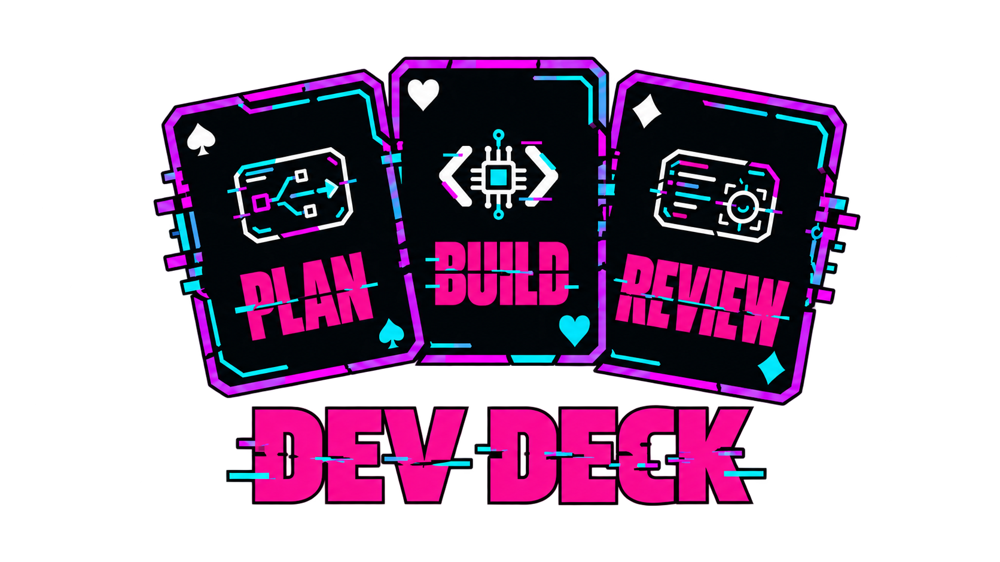

<p align="center"></p>

<p align="center">
  <strong>A three-role agent pipeline: planner, builder, reviewer. Each role runs
  on the model you configure; the reviewer verifies work it did not produce.</strong>
</p>

---

Dev Deck is a set of role definitions, build conventions, and an installer that
wrap third-party agent skills. It pins the workflow skills to maintained
upstream packs (pstack, Matt Pocock's pack, Ponytail, antislop, caveman) and
adds three things you control: three role definitions, your build conventions,
and a cross-stack API contract.

The pipeline has three roles:

- **Planner** — turns a request into a plan and a list of independent tickets.
- **Builder** — implements one ticket at a time, test-first.
- **Reviewer** — checks the diff. It starts a fresh session and only receives
  the diff, the plan entry, and the repo's `AGENTS.md`. It does not see the
  builder's session or self-report, so it verifies the change independently.

## Maintenance model

You maintain roughly 200 lines of your own content. Everything else is pinned
upstream and refreshed by re-running the installer.

| Maintained by you | Pinned upstream (do not edit) |
|---|---|
| 3 role files (`agents/`) | pstack, Matt Pocock, Ponytail, antislop, caveman |
| 3 convention files (`conventions/`) | roadmap |

Your conventions live in `conventions/`. Each project gets a short `AGENTS.md`
that points at them. To update an upstream, change its pin in `upstream.json`
and re-run the installer. To change your conventions, edit the file. Neither
requires rewriting a skill.

## Pipeline flow

```
Task: "add feature X"   (in a repo whose AGENTS.md references Dev Deck)
└─ Main session (any model; the host loads the roles and skills)
   └─ pipeline skill  (orchestrates the three roles; not run by hand)
        ├─ PLANNER   — your strongest model
        │     new session · uses: roadmap, wayfinder/to-spec/to-tickets,
        │     pstack figure-it-out/how/why
        │     produces: .plan/plan.md + .plan/tickets.md
        │
        ├─ BUILDER   — a low-cost model
        │     new session per ticket · uses: implement/tdd, pstack
        │     architect/deslop/no-comments, ponytail
        │     produces: commits on the branch
        │
        └─ REVIEWER  — a strong model from a different provider
              new session · receives ONLY the diff + the plan entry + AGENTS.md
              (not the builder's session or self-report)
              uses: code-review, thermo-nuclear-code-quality-review, blast-radius,
              swarm, ponytail-review/audit, caveman/antislop
              produces: VERDICT: PASS | FAIL + findings
```

The reviewer's isolation is the key design point. A model that just reported the
change as working is biased toward agreeing with itself. A separate model that
only sees the diff and the spec has to verify the claim from evidence.

## Stage-by-stage breakdown

Both upstream packs describe work in six stages, but they cover different
ranges. **pstack** handles build/test/deploy and intentionally omits planning
and maintenance. **Matt's pack** handles planning and runs through to
maintenance. Dev Deck combines them: it uses Matt's planning skills, pstack's
build/test skills, and adds an isolated reviewer.

The three roles automate **Plan → Test**. **Deploy** and **Maintain** are not
part of the automated loop; you invoke those skills directly when needed.

### Stage 1 — Plan

- **Role:** planner (strongest model).
- **Approach:** start from the unknowns, not the idea. Learn the existing
  code, gather the answers the request is missing, then refine the idea into a
  spec and thin, independent tickets. For large or ambiguous work, resolve the
  major decisions before writing the spec.
- **Skills:** Matt `research → to-questionnaire`, `grill-with-docs → to-spec →
  to-tickets`, `wayfinder → to-spec`; pstack `how → why → teach` (read the
  code), `figure-it-out → show-me-your-work` (large or unattended work);
  `roadmap` records the result in the project plan.
- **Gap it fills:** pstack has no requirements-gathering or intent skill.
  Matt's `to-spec` and `roadmap`'s intent step provide it.

### Stage 2 — Design

- **Role:** planner, completed before any build starts.
- **Approach:** fix the shape of the code before writing it. Sketch the types,
  test the risky part with throwaway code, compare candidate approaches and
  keep the best, and have the design reviewed before it becomes expensive.
  Keep the vocabulary and module boundaries explicit.
- **Skills:** pstack `architect → arena → interrogate`; Matt `handoff →
  prototype`, `domain-modeling → codebase-design`.
- **Output:** types/shape plus a recorded decision (an ADR via `roadmap` when
  the decision is hard to reverse).

### Stage 3 — Build

- **Role:** builder (low-cost model, one ticket at a time).
- **Approach:** test-first. Implement one piece (or a whole spec if it was
  sliced small enough). For a bug, reproduce it before fixing it. Follow the
  language's strict rules, then remove unnecessary code and comments from the
  diff. Ponytail applies YAGNI throughout: before adding code, check whether it
  already exists, is in the standard library, is a native feature, is an
  installed dependency, or can be a single line.
- **Skills:** Matt `implement → tdd`, `implement-spec → tdd`,
  `diagnosing-bugs → tdd`; pstack `tdd → typescript-best-practices`, `deslop →
  no-comments`; `ponytail`.

### Stage 4 — Test

- **Role:** reviewer (different model family, isolated — it never saw the
  builder's session).
- **Approach:** verify the change on the running application, not only in
  unit tests. Identify what the change could break, check performance numbers,
  review the diff from multiple angles, and remove anything that can be
  removed.
- **Skills:** pstack `create-verification-skill → swarm`, `blast-radius →
  benchmark-checklist`, `interrogate → thermo-nuclear-code-quality-review`;
  Matt `code-review`; `ponytail-review` / `ponytail-audit`; `caveman` +
  `antislop` keep the output concise.
- **Gap it fills:** Matt's pack has no separate QA/e2e/browser-testing skill —
  testing happens in Build. pstack's verification and swarm skills cover it.

### Stage 5 — Deploy

- **Role:** you. Not part of the automated loop.
- **Approach:** make the pull request easy to review, write a clear
  description, follow it through to merge, and resolve conflicts as they occur.
- **Skills:** pstack `make-pr-easy-to-review → babysit → fix-merge-conflicts →
  get-pr-comments`; Matt `pr → wizard`.
- **Limitation:** pstack's release step stops at the merge. Neither pack
  includes CI/CD, release, or rollout skills.

### Stage 6 — Maintain

- **Role:** you, using `roadmap` to track the plan.
- **Approach:** triage new issues as they arrive, review completed work, and
  keep the plan accurate against what the code actually does.
- **Skills:** Matt `triage → implement`, `retro → improve-codebase-architecture`;
  `roadmap reconcile` for the plan document.
- **Limitation:** neither pack includes monitoring, logs, metrics, or incident
  skills. Maintenance here covers issues, agent setup, and code structure.

### Utility skills (not tied to a stage)

- **Router:** Matt `ask-matt` and pstack's router — "which skill do I need?"
- **Set up once:** Matt `setup-mattpocock-skills`; Dev Deck `init` per project.
- **Interview and re-explain:** `grilling`, `grill-me`, `wait-what`.
- **Learn and write:** `teach`, `writing-for-agents`.

**Order:** Plan → Design → Build → Test are automated. Deploy and Maintain are
manual. This is the sequence the `pipeline` skill runs.

The two packs complement each other because of what each one omits:

- **pstack** omits planning and maintenance; its strength is the Test stage —
  verify on the running app, review the diff, check the numbers.
- **Matt's pack** is built for planning — gather missing answers, refine the
  idea into tickets — and is the only one of the two that reaches maintenance
  (triage, retro, architecture).
- **Dev Deck** adds the isolated reviewer, which neither pack provides on its
  own. That step is the difference between "the agent says it works" and "a
  separate model confirmed it."

Deploy and Maintain are manual steps. When the reviewer returns PASS, you take
the branch to a pull request (or merge) yourself. When a project becomes stale,
`roadmap reconcile` and Matt's `triage`/`retro` are the tools to use; they are
installed but do not run automatically.

## The roles

| Role | Model slot | Uses | Produces |
|---|---|---|---|
| **Planner** | strongest (`{{PLANNER}}`) | roadmap, Matt planning, pstack learn/plan | plan + tickets under `.plan/` |
| **Builder** | low-cost (`{{BUILDER}}`) | Matt implement, pstack build/clean, ponytail | commits on the branch |
| **Reviewer** | different-family strong (`{{REVIEWER}}`), isolated | Matt code-review, pstack test, ponytail-review, caveman/antislop | PASS / FAIL + findings |

Each role is a small markdown file. The `model:` frontmatter is a placeholder
the installer fills from your config, so no model is hard-coded in a shipped
file.

## Quickstart

**Install (Windows):**
```powershell
git clone <this repo> C:\dev\dev-deck
cd C:\dev\dev-deck
copy dev-deck.config.json.example dev-deck.config.json
# edit dev-deck.config.json: set your model slots and hosts
.\install\install.ps1
```

**Install (macOS / Linux):**
```bash
git clone <this repo> ~/dev-deck
cd ~/dev-deck
cp dev-deck.config.json.example dev-deck.config.json
# edit dev-deck.config.json
./install/install.sh
```

The installer pulls the pinned upstreams, copies their skills into your host's
global skill directory, writes the three role files (models substituted),
writes the `pipeline` and `init` skills, and registers the Context Mode MCP
server. It is idempotent — run it again at any time to refresh.

**Set up a project:** in any repo, invoke the **init** skill. It reads your
manifests, drafts a short `AGENTS.md` (your stack, a pointer to the house
style, the commit format, and a pipeline note), and writes it without
overwriting anything that is already there.

**Run the pipeline:** in a configured repo, invoke the **pipeline** skill on a
feature. It runs planner → builder → reviewer and returns the verdict.

## Updating

- **Refresh an upstream:** change its pin in `upstream.json`, then re-run
  install.
- **Verify:** run `install\doctor.ps1` (or `install/doctor.sh`) — it checks
  that pins are current, there are no skill-name collisions, the roles are in
  place, and the MCP server is reachable.

## Swapping hosts or machines

Edit `dev-deck.config.json` (model slots and `hosts` list) and re-run install.
The roles and conventions are host-agnostic markdown; the installer maps them
onto the hosts you enable. On a new machine, clone the repo, fill in the
config, and run `install.sh` or `install.ps1`.

Supported hosts: **Claude Code, Codex, OpenCode, Pi, DeepSeek harness.** Claude
Code, Codex and OpenCode get the three roles as native subagents (Claude Code
`~/.claude/agents`, Codex `~/.codex/agents` as TOML, OpenCode
`~/.config/opencode/agents`). Pi and DeepSeek have no subagent format here, so
they get the skills only.

## Contributing

- **Add a convention:** add a file in `conventions/`. Reference it from
  `agents/reviewer.md` and `conventions/code-style.md` so it is enforced.
- **Add an upstream pin:** add a row to `upstream.json` (name, url, ref,
  skillsPath). Re-run install.
- **Change a role's behavior:** edit `agents/<role>.md`.
- **Add a host:** add a mapping in `install.ps1` / `install.sh`.

## FAQ

- **Why does the reviewer see nothing from the builder?** A model that
  reported the change as working is biased toward agreeing with itself. The
  reviewer is a fresh, different-family model handed only the diff, the plan
  entry, and the repo's rules. It must verify the claim from evidence.
- **Why are models in `dev-deck.config.json` and not in the role files?** So
  no model is hard-coded in a shipped file. Anyone can point a role at any
  available model, or leave it blank to inherit the host's default.
- **What happens when the reviewer fails?** The builder receives the findings
  as a new ticket, then the review runs again. This is capped at 2 loops —
  after that, the pipeline stops and returns the open findings, because the
  loop is not converging and a human decision is needed.
- **Why are there no per-stack convention packs?** Each repo's `AGENTS.md`
  owns its own stack rules. A global pack library is a maintenance burden; the
  global file holds your taste, and the local file holds the project's actual
  setup.
- **Does each repo get a config file?** No. Projects get only their
  `AGENTS.md`. Model overrides live in the single `dev-deck.config.json`, or in
  an optional per-project `.dev-deck.json` for one repo on a stronger model.

## License

MIT.

<sub>The cross-stack contract (`conventions/contract.md`) and the isolated
reviewer pattern (`agents/reviewer.md`) are adapted from a private work
playbook. Company-specific content was removed.</sub>
